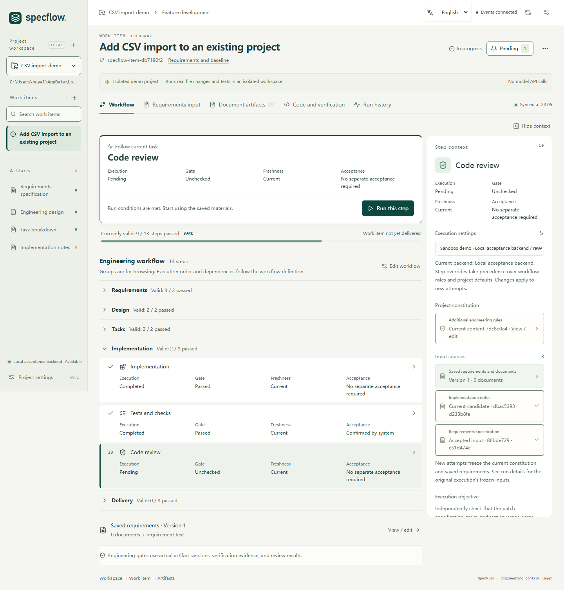

<p align="center">
  
</p>

<h1 align="center">SpecFlow</h1>

<p align="center">
  <strong>From requirements to reviewed code.</strong><br>
  A spec-driven engineering workbench for local Git repositories.
</p>

<p align="center">
  <a href="https://github.com/HuYellow/specflow/releases/latest">Download desktop</a>
  &nbsp;&middot;&nbsp;
  <a href="#deepseek-harness-plugin">DSH plugin</a>
  &nbsp;&middot;&nbsp;
  <a href="#development">Run from source</a>
  &nbsp;&middot;&nbsp;
  <a href="README.zh-CN.md">简体中文</a>
</p>

<br>

<p align="center">
  
</p>

<p align="center">
  <sub>The built-in CSV demo in the English workbench. Switch between English and Simplified Chinese from the header.</sub>
</p>

<br>

SpecFlow connects specifications, model execution, real tests, and human acceptance in one local workbench. Every change carries a record of what was requested, what ran, what passed, and what you accepted.

Use the standalone desktop app or work inside DeepSeek Harness through its native side-panel plugin.

<p>
  <a href="#overview">Overview</a> &nbsp;&middot;&nbsp;
  <a href="#get-started">Get started</a> &nbsp;&middot;&nbsp;
  <a href="#workflow">Workflow</a> &nbsp;&middot;&nbsp;
  <a href="#execution-backends">Backends</a> &nbsp;&middot;&nbsp;
  <a href="#development">Development</a> &nbsp;&middot;&nbsp;
  <a href="#documentation">Documentation</a>
</p>

## Overview

### Traceable inputs

Each attempt records its requirements, project rules, document revisions, model, and execution identity. When an upstream input changes, dependent results become stale.

### Verified candidates

Review passes examine coverage and failure cases against the same frozen materials. SpecFlow runs your project's verification commands and records their output, exit codes, and the code version tested. Changes to code or commands invalidate old evidence.

### Explicit acceptance

Review documents, diffs, findings, and test results at each checkpoint. Before you accept a change, SpecFlow checks that the required evidence still matches the current work.

## Get started

Choose **English** or **中文** in the workbench header. On first launch the interface follows your system or browser language; your selection is saved. The desktop menu, dialogs, status messages, and document exports follow the selected interface language.

New work items use the selected language for their default workflow, generated documents, briefs, and clarification questions. To change the output language for a new run of an existing work item, open the workflow editor and choose **Generated content language**. Existing attempts, user content, code, logs, and quoted evidence retain their original text. The DeepSeek Harness plugin provides the same language selector within its panel.

### Desktop app

**[Download the latest release](https://github.com/HuYellow/specflow/releases/latest)**

| Platform | Installer |
| --- | --- |
| Windows x64 | `SpecFlow-<version>-win-x64.exe` |
| macOS · Apple Silicon | `SpecFlow-<version>-mac-arm64.dmg` |
| macOS · Intel | `SpecFlow-<version>-mac-x64.dmg` |

The app includes Electron, Node.js 24, npm, and the Maka Runtime Host. Install **Git** separately, along with the tools your project's tests and build commands require.

<details>
<summary>Installer checksums, signing, and updates</summary>

Release assets include `SHA256SUMS.txt`. Current installers are unsigned; macOS builds are also not notarized.

Windows supports in-place updates through the app's Help menu. For current macOS builds, download a new DMG and replace the app. See the [desktop installation and update guide](docs/implementation/desktop.md).

</details>

#### Your first session

1. **Explore the demo.** The built-in CSV example changes code and runs real Node.js tests in an isolated repository, using deterministic results without calling a model API.
2. **Connect a repository.** Add a local Git project with a clean, committed baseline.
3. **Configure the project.** Add a model connection and choose models for the analyst, architect, developer, and reviewer roles. Set project rules and verification commands.
4. **Describe a change.** Create a work item and optionally attach Markdown or TXT requirements.
5. **Work through the checkpoints.** Clarify the specification, review and accept the design and tasks, then run implementation and verification.
6. **Accept the result.** Inspect the candidate diff, findings, and evidence before integrating into the work-item branch.

### DeepSeek Harness plugin

Run the same engineering core in a **Specflow** tab beside your DSH conversation, using the models configured in your host.

**[npm · dsh-plugin-specflow 0.1.1](https://www.npmjs.com/package/dsh-plugin-specflow)** · [GitHub release](https://github.com/HuYellow/specflow/releases/tag/dsh-plugin-specflow%400.1.1) · [Plugin guide](plugins/deepseek-specflow/README.md)

Requires **DSH `0.2.1-rc.2`**, **host Node.js 24+**, and **local Git**. The desktop app, Maka, and OpenCode are not required. Other DSH versions need separate validation.

In DSH, open **Plugins → Install Third-Party Plugin** and enter `dsh-plugin-specflow@0.1.1`. Enable it and open the Specflow workbench in the right sidebar. The panel links the current conversation's repository automatically; you can also select a repository manually. Assign role models and verification commands, then create a work item.

For a catalog that accepts a public **npm package URL**, use [https://www.npmjs.com/package/dsh-plugin-specflow](https://www.npmjs.com/package/dsh-plugin-specflow). The [GitHub release](https://github.com/HuYellow/specflow/releases/tag/dsh-plugin-specflow%400.1.1) also provides a prebuilt `.tgz` and `SHA256SUMS.txt`; DSH accepts the tarball URL or its local absolute path.

To update an installed plugin, save edits and stop active Specflow operations, uninstall it in the same DSH profile, install the new package, and restart DSH. Engineering data is retained. If you configured a custom `dataDir`, keep that value after reinstalling.

<details>
<summary>CLI installation and custom plugin market</summary>

For the CLI/Web profile:

```sh
dsh plugin --profile web add dsh-plugin-specflow@0.1.1
dsh web
```

You can also use the project's [custom plugin-market index](https://raw.githubusercontent.com/HuYellow/specflow/main/market/dsh/index.json), which pins the prebuilt Git distribution to its release commit.

The panel handles workflow actions and human acceptance. The chat tool `specflow_query` provides read-only project status. Installation, data locations, development, and recovery are covered in the [plugin guide](plugins/deepseek-specflow/README.md).

</details>

## Workflow

Each registered repository is a project. Each work item has its own branch and workspace; implementation runs in a separate candidate worktree.

| Phase | What you work with |
| --- | --- |
| **Specify & clarify** | Requirements, supporting documents, acceptance criteria, and answers written back into the specification |
| **Design & break down** | A reviewed design and tasks with dependencies and acceptance conditions |
| **Implement & verify** | Candidate code, task progress, and results from your verification commands |
| **Review & align** | Findings and a report connecting requirements, tasks, code, and evidence |
| **Accept** | A final freshness and evidence check, followed by your decision to integrate |

The default workflow has **13 steps**, including dedicated reviews between the main phases. Editing a requirement or document creates a new revision that must pass the relevant checks again.

Full Markdown documents remain the execution contract. Short reading briefs stay linked to the same source revisions; the desktop workbench also provides offline HTML export. Accepted documents retain their history and are exported with the work item.

> **When requirements change**
>
> Changing a CSV requirement from accepting malformed rows to rejecting them makes dependent work stale, even if earlier tests passed. Acceptance checks that the documents, reviews, and test results apply to the updated inputs and candidate code.

Accepted code is integrated into the **local work-item branch**. Publishing that branch or opening a pull request remains part of your Git workflow.

## Execution backends

SpecFlow manages the workflow, input versions, evidence, and acceptance rules. Your selected backend runs the model sessions.

| Backend | Setup | Models |
| --- | --- | --- |
| **Maka** · desktop default | Runtime Host included with the app | Add connections in SpecFlow; Maka manages provider credentials |
| **OpenCode** · desktop option | Separately installed local service | Configure providers in trusted OpenCode user settings |
| **DSH** · plugin | Compatible Harness host | Use models configured in DSH |

Changing a project's backend applies to new attempts. Existing attempts keep their original backend, model, and session identity. OpenCode and DSH can recover the status of an interrupted run; continuing the work requires an explicit new attempt.

<details>
<summary>Connect a local OpenCode service</summary>

```sh
opencode serve --hostname 127.0.0.1 --port 4096
```

Choose OpenCode in project settings, save the connection and optional authentication, refresh the model list, and assign role models.

SpecFlow accepts loopback endpoints only. Repository-level `opencode.json`, `opencode.jsonc`, and `.opencode` configuration are currently blocked; use trusted user-level configuration.

See [backend setup and switching](docs/implementation/execution-backends.md) and the [OpenCode adapter notes](packages/opencode-adapter/README.md).

</details>

<details>
<summary>Bundled Maka release policy</summary>

The runtime is built from the **signed official Apache Maka 0.2.0 source release** (`0.2.0-incubating`). [The release manifest](config/maka-release.json) pins the source version, SHA-512 checksum, and signer fingerprint.

Only Runtime Host and its production dependencies ship with the desktop app. Source, compiler, tests, CLI/Eval, and build caches stay outside the package.

Setup, runtime loading, and packaging enforce the same policy: development, nightly, snapshot, RC, and placeholder builds are rejected. If the approved release cannot be obtained or adapted, the build fails. A formal npm package will replace this source-build path once publishing is resolved.

</details>

## Development

Use **Node.js 24+, npm, Git, and GPG**. Setup needs network access to verify and build the pinned Maka release. On Windows, GPG bundled with Git can be used; on macOS, install GnuPG separately.

```sh
git clone https://github.com/HuYellow/specflow.git
cd specflow
npm ci
npm run maka:setup
npm run desktop:dev
```

For browser development, run `npm run dev` after setup and open [localhost:4318](http://127.0.0.1:4318). To serve a production build, run `npm run build`, then `npm start`, and open [localhost:4317](http://127.0.0.1:4317).

<details>
<summary>Verification and desktop packaging</summary>

Core checks:

```sh
npm run typecheck
npm test
npm run build
npm run maka:probe
```

The probe exercises the prepared Maka Host. Tests that require it explicitly skip when the approved runtime has not been prepared.

Build installers on the matching operating system and CPU architecture:

```sh
npm run desktop:package:win        # Windows x64
npm run desktop:package:mac:arm64  # Apple Silicon Mac
npm run desktop:package:mac:x64    # Intel Mac
```

Installers are written to `release/`. Release automation and signing are documented in the [desktop delivery guide](docs/implementation/desktop.md).

For plugin development, install its separate dependencies and use `dsh:typecheck`, `dsh:test`, and `dsh:pack` as described in the [plugin guide](plugins/deepseek-specflow/README.md#在本仓库开发和发布).

</details>

## Local data and execution

Project records, workspaces, and run logs are stored locally. Model requests go through the provider configured in the selected backend. Desktop, browser, and DSH installations use separate data directories and do not automatically migrate existing data.

Workspace file restrictions are application controls, not an operating-system sandbox. Verification commands run with your user permissions. The quality of model reviews and test evidence depends on the models and checks you configure.

<details>
<summary>Default data directories</summary>

| Entry point | Engineering data directory |
| --- | --- |
| Desktop · Windows | `%APPDATA%/SpecFlow/engineering` |
| Desktop · macOS | `~/Library/Application Support/SpecFlow/engineering` |
| Browser workbench | `.specflow-data/local` |
| DSH plugin | `$DSH_HOME/specflow`, or `~/.dsh/specflow` with the default DSH home |

Use `SPECFLOW_DATA_DIR` to override the browser data directory; the plugin has its own `dataDir` setting. Desktop uninstall preserves engineering data.

</details>

## Documentation

Most detailed implementation notes are currently in Chinese.

| Topic | Guides |
| --- | --- |
| Installation & distribution | [Desktop](docs/implementation/desktop.md) · [DSH plugin](plugins/deepseek-specflow/README.md) · [Plugin publication](docs/implementation/dsh-publication.md) |
| Runtime integration | [Execution backends](docs/implementation/execution-backends.md) · [Maka management](docs/implementation/maka-runtime-management.md) |
| Inputs & clarification | [Requirements](docs/implementation/requirements-input.md) · [Project guidance](docs/implementation/constitution-clarify.md) |
| Documents & review | [Reading briefs](docs/implementation/dual-audience-documents.md) · [Review policy](docs/implementation/self-correction.md) |
| Execution control & automatic repair | [Policies, recovery and bounded repair](docs/implementation/agent-loop-optimization.md) · [UI validation](docs/implementation/agent-loop-qa/README.md) · [Evaluation tools](docs/implementation/agent-evaluation.md) |

Automatic advancement and bounded repair are opt-in from the workflow view. Required clarification, tool permissions, independent review and human acceptance still apply. Execution details preserve deadlines, original backend identities and unknown usage rather than treating missing measurements as zero.

---

[Apache License 2.0](LICENSE) · Bundled components retain their respective licenses and notices.
