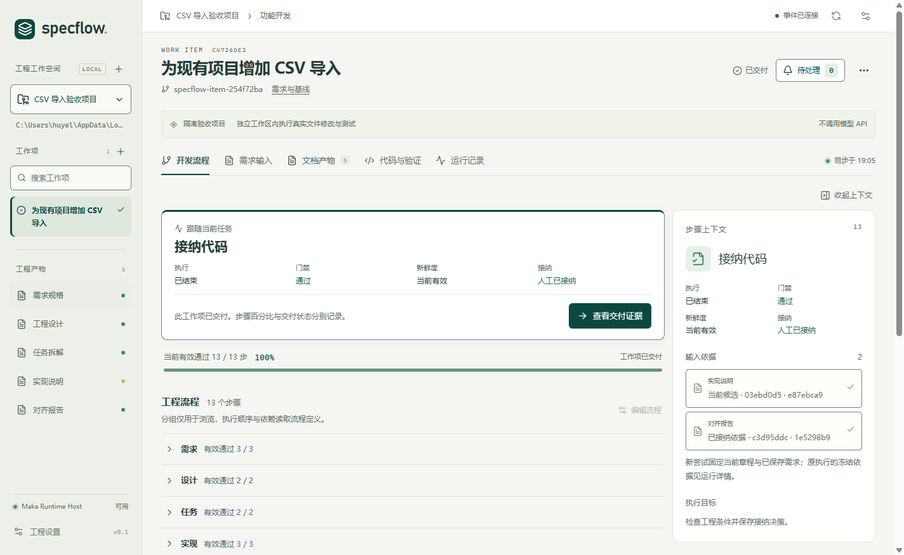

# SpecFlow

**Spec-driven development for your local Git repository.**

English | [简体中文](README.zh-CN.md)

[Download desktop app](https://github.com/HuYellow/specflow/releases/latest) · [Install DSH plugin](#deepseek-harness-plugin) · [Run from source](#run-from-source)

SpecFlow takes a software change from an initial requirement to reviewed code, with a record of the inputs, model runs, test results, and decisions behind it. Specifications, implementation, verification, and human acceptance live in one local engineering workbench.

Use the standalone desktop app with the bundled **Apache Maka Runtime Host** or a local **OpenCode** service. If you work in **DeepSeek Harness (DSH)**, install the native side-panel plugin and use the models already configured in your host.



*The built-in CSV demo in the desktop workbench. The current interface and built-in workflow prompts are primarily in Chinese.*

## Why SpecFlow

A useful change needs a clear answer to three questions: what was requested, what was checked, and what was accepted. SpecFlow keeps those answers connected as the work evolves.

- **Know what a run was based on.** Each attempt records the saved requirements, project rules, document revisions, model, and execution identity it used. Change an upstream input and dependent results become stale.
- **Review the work before it moves forward.** Specifications, designs, task breakdowns, and alignment reports have review and acceptance checkpoints. Reviews use separate coverage and adversarial passes against the same frozen materials.
- **Test the actual candidate.** SpecFlow runs your project's verification commands and records exit codes, output, and the code version tested. Code or command changes invalidate old evidence.
- **Keep the final decision explicit.** Inspect documents, diffs, findings, and test results before accepting a change. Acceptance checks that the required evidence still matches the current work.
- **Read at the right level of detail.** Full Markdown documents provide the execution contract. Short reading briefs stay linked to their source revisions, with offline HTML export available in the desktop workbench.

## Get started

### Desktop app

Download an installer from [GitHub Releases](https://github.com/HuYellow/specflow/releases/latest):

| Platform | Installer |
| --- | --- |
| Windows x64 | `SpecFlow-<version>-win-x64.exe` |
| macOS · Apple Silicon | `SpecFlow-<version>-mac-arm64.dmg` |
| macOS · Intel | `SpecFlow-<version>-mac-x64.dmg` |

The app bundles Electron, Node.js 24, npm, and the Maka Runtime Host. Install **Git** separately, along with any tools your project's tests or build commands require. Release assets include `SHA256SUMS.txt`.

Current installers are unsigned; macOS builds are also not notarized. Windows supports in-place updates through the app's Help menu. For current macOS builds, download a new DMG and replace the app. See the [desktop installation and update guide](docs/implementation/desktop.md) for details.

For your first session:

1. Open SpecFlow and try the built-in CSV demo. It changes code and runs real Node.js tests in an isolated example repository, using deterministic results without calling a model API.
2. Add your own Git repository with a clean, committed baseline.
3. In project settings, configure a model connection and choose models for the **analyst, architect, developer, and reviewer** roles. Add your project rules and verification commands.
4. Create a work item, describe the change, and optionally attach Markdown or TXT requirements.
5. Work through the specification, clarification, design, and task checkpoints. Review and accept the documents, then run implementation and verification.
6. Inspect the candidate diff, review findings, and test evidence. Accept the completed change into its work-item branch when the checks pass.

### DeepSeek Harness plugin

The plugin brings the same engineering core into a **Specflow** tab beside your DSH conversation. It uses DSH's model configuration and separate execution sessions; the desktop app, Maka, and OpenCode are not required.

**Compatibility:** DSH **`0.2.1-rc.2`**, host Node.js **24+**, and local Git. Other DSH versions need separate validation.

Download the prebuilt `.tgz` from the [plugin release](https://github.com/HuYellow/specflow/releases/tag/dsh-plugin-specflow%400.1.0) and install it through DSH's third-party plugin manager. For the CLI/Web profile:

```sh
dsh plugin --profile web add https://github.com/HuYellow/specflow/releases/download/dsh-plugin-specflow%400.1.0/dsh-plugin-specflow-0.1.0.tgz
dsh web
```

Enable the plugin, open a DSH session, and select the Specflow workbench in the right sidebar. Register your repository, configure role models and verification commands, and create a work item. The panel handles workflow actions and human acceptance; the chat tool `specflow_query` provides read-only project status.

You can also install through the project's [custom plugin-market index](https://raw.githubusercontent.com/HuYellow/specflow/main/market/dsh/index.json). See the [plugin guide](plugins/deepseek-specflow/README.md) for installation, data locations, development, and recovery.

## How a change moves through the workbench

Each registered Git repository is a project. Each work item has its own branch and workspace, and implementation runs in a separate candidate worktree.

| Phase | What you work with |
| --- | --- |
| Specify and clarify | Requirements, supporting documents, acceptance criteria, and answers written back into the specification |
| Design and break down | A reviewed design and a task list with dependencies and acceptance conditions |
| Implement and verify | Candidate code, per-task progress, and results from your configured verification commands |
| Review and align | Code review findings and a report connecting requirements, tasks, code, and evidence |
| Accept | A final freshness and evidence check, followed by your decision to integrate into the work-item branch |

The default workflow has 13 steps, including dedicated reviews between the main phases. You can edit requirements and document candidates; a new revision must go through the relevant checks again. Accepted documents retain their revision history and are exported with the work item.

For example, changing a CSV requirement from accepting malformed rows to rejecting them makes the dependent work stale, even if the earlier tests passed. Before acceptance, SpecFlow checks that the documents, reviews, and test results apply to the updated inputs and candidate code.

Acceptance writes to the **local work-item branch**. Publishing that branch or opening a pull request remains part of your Git workflow.

## Choose an execution backend

SpecFlow owns the workflow, input versions, evidence, and acceptance rules. The execution backend runs the model sessions.

| Backend | Setup | Model configuration |
| --- | --- | --- |
| **Maka** · desktop default | Runtime Host included in the desktop app | Add provider connections in SpecFlow; Maka manages the provider credentials |
| **OpenCode** · desktop option | Install OpenCode separately and start a local service | Configure providers in trusted OpenCode user settings, then connect SpecFlow |
| **DSH** · plugin | Install the plugin in a compatible Harness host | Select from the models configured in DSH |

To use OpenCode, start the service:

```sh
opencode serve --hostname 127.0.0.1 --port 4096
```

Then choose OpenCode in project settings, save the local connection and optional authentication, refresh the model list, and assign role models. SpecFlow accepts loopback endpoints only. Repository-level `opencode.json`, `opencode.jsonc`, and `.opencode` configuration are currently blocked; use trusted user-level configuration. See [backend setup and switching](docs/implementation/execution-backends.md) and the [OpenCode adapter notes](packages/opencode-adapter/README.md).

Changing a project's backend applies to new attempts. Existing attempts retain their original backend, model, and session identity for status checks and execution control. OpenCode and DSH can recover the status of an interrupted run; continuing the work requires an explicit new attempt.

### Bundled Maka release policy

The bundled runtime is built from the **signed official Apache Maka 0.2.0 source release** (`0.2.0-incubating`). [The release manifest](config/maka-release.json) pins the source version, SHA-512 checksum, and signer fingerprint.

Only Runtime Host and its production dependencies ship with the desktop app. Source, compiler, tests, CLI/Eval, and build caches stay outside the package. Setup, runtime loading, and packaging enforce the same policy: development, nightly, snapshot, RC, and placeholder builds are rejected. If the approved release cannot be obtained or adapted, the build fails. A formal npm package will replace this source-build path once publishing is resolved.

## Run from source

Use **Node.js 24+, npm, Git, and GPG**. Setup needs network access to verify and build the pinned Maka release. On Windows, GPG bundled with Git can be used; on macOS, install GnuPG separately.

```sh
git clone https://github.com/HuYellow/specflow.git
cd specflow
npm ci
npm run maka:setup
npm run desktop:dev
```

For browser development, run `npm run dev` after setup and open [localhost:4318](http://127.0.0.1:4318). To serve a production build, run `npm run build`, then `npm start`, and open [localhost:4317](http://127.0.0.1:4317).

Core checks:

```sh
npm run typecheck
npm test
npm run build
npm run maka:probe
```

The probe exercises the prepared Maka Host. Tests that require it explicitly skip when the approved runtime has not been prepared.

Build desktop installers on the matching operating system and CPU architecture:

```sh
npm run desktop:package:win        # Windows x64
npm run desktop:package:mac:arm64  # Apple Silicon Mac
npm run desktop:package:mac:x64    # Intel Mac
```

Installers are written to `release/`. For plugin development, install its separate dependencies and use the `dsh:typecheck`, `dsh:test`, and `dsh:pack` scripts described in the [plugin guide](plugins/deepseek-specflow/README.md#在本仓库开发和发布). Release automation and signing are documented in the [desktop delivery guide](docs/implementation/desktop.md).

## Data and execution boundaries

Project records, workspaces, and run logs are stored locally. Model requests go through the provider configured in the selected backend. Desktop, browser, and DSH installations use separate data directories and do not automatically migrate existing data.

| Entry point | Default engineering data directory |
| --- | --- |
| Desktop · Windows | `%APPDATA%/SpecFlow/engineering` |
| Desktop · macOS | `~/Library/Application Support/SpecFlow/engineering` |
| Browser workbench | `.specflow-data/local` |
| DSH plugin | `$DSH_HOME/specflow`, or `~/.dsh/specflow` with the default DSH home |

Use `SPECFLOW_DATA_DIR` to override the browser data directory; the DSH plugin has its own `dataDir` setting. Desktop uninstall preserves engineering data.

Workspace file restrictions are application controls, not an operating-system sandbox. Verification commands run locally with your user permissions. Model reviews and passing tests provide evidence for your decision; their quality depends on the selected models and the checks you configure.

## Project documentation

Most detailed implementation notes are currently in Chinese.

- [Desktop installation, updates, packaging, and releases](docs/implementation/desktop.md)
- [DSH plugin guide](plugins/deepseek-specflow/README.md) and [publication workflow](docs/implementation/dsh-publication.md)
- [Execution backends](docs/implementation/execution-backends.md) and [Maka runtime management](docs/implementation/maka-runtime-management.md)
- [Requirements and input revisions](docs/implementation/requirements-input.md)
- [Project guidance and clarification](docs/implementation/constitution-clarify.md)
- [Documents and reading briefs](docs/implementation/dual-audience-documents.md)
- [Review policy and rechecking findings](docs/implementation/self-correction.md)

## License

[Apache License 2.0](LICENSE). Bundled components retain their respective licenses and notices.
