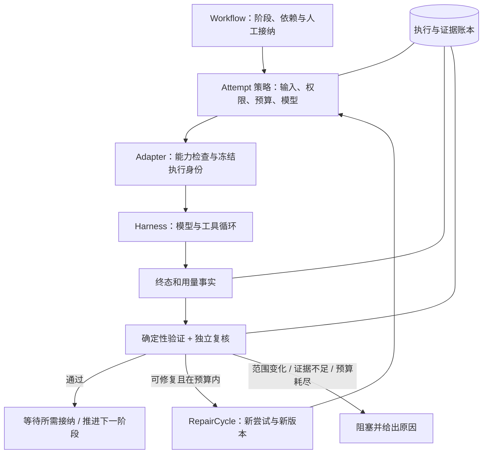

# SpecFlow Agent 执行与工程流程优化设计

日期：2026-10-27。状态：设计基线；P0、P1、P2-A 与评估工具已实施，具体交付和验证见[实施记录](../implementation/agent-loop-optimization.md)。下文源码观察基于改造前提交 `3217d7517a301e6cb2a5654a2bca14c6b25c5429`，行号属于该基线。

## 1. 设计结论

SpecFlow 应继续以确定性的工程流程管理规格、任务、证据和接纳，在每个阶段内使用受约束的 agent 执行。下一步优先补齐持久化预算、停止原因、恢复队列和用量记录，再增加有上限的修订循环、任务上下文和流程自动推进。

当前冻结输入、独立复核、真实验证、候选隔离和执行身份链已经构成可靠基础。它们比引入新的编排框架更值得保留。本提案不要求引入 Vercel AI SDK，也不要求更换 Maka；借鉴的是控制机制和评估方法。

建议依次交付：

1. **P0：控制与观测准确。** 能解释为什么停、是否真的停、花了多少、重启后还能否继续。
2. **P1：受约束的自动修订与推进。** 在同一工程目标内生成新尝试，遇到必要交互、范围变化或预算耗尽就停。
3. **P2：减少无效上下文与重复验证。** 建立结构化任务、证据清单和上下文交接。
4. **P3：用实测决定进一步简化或并行。** 先评估双视角并行和流程模板，编码并行另立设计。

以下接口、默认值和模块名称记录 SpecFlow 的设计约束，不代表上游框架保证。具体已实现接口、范围和验证结果以实施记录及当前源码为准。

## 2. 一手资料与适用边界

### 2.1 Anthropic：Building effective agents

原文发表于 2024-12-19，强调简单可组合的模式：固定路径用 workflow，开放任务用 agent；增加复杂度需要效果依据。工具反馈与环境执行结果用于判断进展，迭代需要停止条件。Evaluator–optimizer 适用于评价标准清晰、反馈可推动改进的任务。工具描述与接口设计属于 agent 质量的一部分。[原文](https://www.anthropic.com/research/building-effective-agents)

**对本项目的推论：** 工程阶段、版本约束和接纳规则继续由代码掌握；agent 负责阶段内分析和修改。自动修订必须消费具体失败证据，不能只追加“再检查一次”。

原文页面也提示，2024 年的工具生态已经变化。本设计采用其架构原则，并结合下列更新资料；不把旧示例当作当前产品接口。

### 2.2 Vercel：Loop Control

截至调研日，页面为 AI SDK v7：`stopWhen` 在末步含工具结果时决定循环是否继续；多个条件按“任一满足”停止。`ToolLoopAgent` 默认 20 步，`WorkflowAgent` 没有默认步数上限。`prepareStep` 在模型步开始前调整设置、工具和上下文。自然结束、等待工具结果或审批也会结束当前循环。[Loop Control](https://ai-sdk.dev/docs/agents/loop-control)

这些机制不能替代外部超时、正在执行的工具取消，也不能证明工程验收通过。SpecFlow 应分别记录执行终止、工程门禁和人工接纳。

版本差异需要单独处理：v6 的 `stepCountIs` 在 v7 改名为 `isStepCount`；v7 的 `prepareStep` 消息和 instructions 覆盖可传递到后续步，v6 为当步覆盖。本文不建议直接复制旧版示例代码。[官方 v7 迁移指南](https://ai-sdk.dev/docs/migration-guides/migration-guide-7-0)

### 2.3 补充资料

| 官方资料 | 经核对的核心思想 | SpecFlow 设计推论 |
| --- | --- | --- |
| [Effective context engineering for AI agents](https://www.anthropic.com/research/effective-context-engineering-for-ai-agents) | 上下文是有限资源；按需取信息、压缩与结构化笔记用于长期任务 | 版本化证据与模型可见视图分开；压缩不替代审核依据 |
| [Effective harnesses for long-running agents](https://www.anthropic.com/research/effective-harnesses-for-long-running-agents) | 初始化、增量任务、进度记录、测试和 Git 提交帮助跨会话交接 | 复用现有 TaskRun/checkpoint，交接当前任务状态和待解决问题 |
| [Demystifying evals for AI agents](https://www.anthropic.com/research/demystifying-evals-for-ai-agents) | 区分任务、trial、轨迹与环境结果；组合确定性、模型和人工评判 | 建立真实工程任务评估集，分别度量质量、可靠性、成本和介入次数 |

## 3. 当前实现：已有能力与真实缺口

仓库中的部分早期文档仍描述开发快照或“暂缓底座切换”，属于历史材料。本设计以当前源码、`AGENTS.md`、正式发布配置和最新执行底座文档为准。

### 3.1 应保留的能力

| 当前事实 | 代码证据（基线行号） | 设计意义 |
| --- | --- | --- |
| 执行、门禁、新鲜度、接纳分离 | [domain](../../packages/domain/index.ts) 第 10–11、28 行；[flowSelectors](../../apps/web/src/flowSelectors.ts) 第 17–25 行 | 不因 agent 声称完成或执行终止而放行 |
| Attempt 冻结输入、目标和代码依据 | [domain](../../packages/domain/index.ts) 第 29–31 行；[service](../../packages/specflow-core/service.ts) 第 254、347 行起 | 重试与底座切换保留原身份 |
| 同批次双视角复核，保留历史 blocker | [service](../../packages/specflow-core/service.ts) 第 385 行起；[review-policy](../../packages/review-policy/index.ts) | 修复必须复验，不能换报告洗掉问题 |
| 每任务真实验证并创建候选 checkpoint | [service](../../packages/specflow-core/service.ts) 第 478–521 行 | 能把进展绑定到实际代码与测试 |
| 原身份核对与有条件恢复 | [service](../../packages/specflow-core/service.ts) 第 766–836 行 | 不确定的派发不自动重发 |
| 接纳前核对代码、上游、审核和验证 | [service](../../packages/specflow-core/service.ts) 第 648–742 行 | 自动化也必须通过同一工程规则 |
| 桌面与 DSH 共用工程核心 | [server facade](../../apps/server/src/service.ts)；[core service](../../packages/specflow-core/service.ts) | 优化必须覆盖两个入口 |

双视角使用隔离会话，不等于两次语义判断的错误相互独立。现有测试证明结构和门禁行为，不能据此声称真实模型纠错率已经提高。

### 3.2 优先解决的缺口

| 优先级 | 当前事实与定位 | 影响与改造方向 |
| --- | --- | --- |
| P0 | [service](../../packages/specflow-core/service.ts) 第 492 行把相同 `maxSteps` 复制给每个任务 | 现有步数上限作用于单次底座执行；增加阶段、修订周期和运行的累计预算，明确计量单位 |
| P0 | 同文件第 505 行逐任务覆盖 usage，第 521 行合成终态没有 usage，第 544 行再次赋值 | 不能当作阶段累计用量；按执行绑定记录账本并去重汇总，缺失记 unknown |
| P0 | 同文件第 440–476 行的超时是内存 timer；第 766–836 行核对/恢复没有重建持久 deadline | 重启和恢复后的资源边界不完整；持久化 deadline 与停止意图 |
| P0 | 同文件第 511、795 行调用验证未传取消信号；第 615 行循环全部验证命令 | 外层停止可能无法覆盖任务内验证；统一取消域与命令级剩余时间 |
| P0 | [execution-contract](../../packages/execution-contract/index.ts) 第 5–9 行只有粗粒度终态与能力 | 无法结构化解释停止原因、取消是否确认、用量是否完整 |
| P0 | [service](../../packages/specflow-core/service.ts) 第 80 行启动恢复扫描未包含已处于 `reconciling` 的尝试 | 中断期间再次重启时，核对工作应进入持久队列，覆盖所有未确认身份 |
| P1 | 修订依赖用户重跑；现有自动派发主要是复核第二视角 | 增加可停、可恢复、有次数上限的 RepairCycle，不递归调用整个 workflow |
| P2 | [domain](../../packages/domain/index.ts) 第 109–126 行从 Markdown 整行提取 T 编号并将整行作为 condition | 依赖、任务描述和验收条件缺少独立结构；迁移到 TaskSpec |
| P2 | [service](../../packages/specflow-core/service.ts) 第 492 行追加当前任务，但没有结构化前序完成交接；第 615 行每任务运行全部命令 | 相关上下文和验证选择可更精确；最终接纳仍执行必需全量验证 |
| P2 | [Maka adapter](../../packages/maka-adapter/index.ts) 第 11–14 行限制单次文本 48 KiB | 增加字节预检和上下文清单；超限仍明确阻塞，后续证据读取需要专门验收 |

以上是源码审查结果，本次没有运行真实模型或故障复现。用量、超时与取消问题应在实施 P0 时添加针对性的回归场景。

## 4. 目标结构：工程控制与底座循环分层

三种边界必须分别命名：

- **WorkflowRun**：工程步骤与接纳依赖。流程图保持可编译的阶段结构。
- **RepairCycle**：对一个明确目标的有限修订。每轮记录 producer attempt、验证、review group 和修复依据。
- **ExecutionBinding**：一个底座 session/turn/run 的身份。模型工具循环由该底座执行。

`prepareAttempt` 是建议新增的跨底座派发前策略入口。它不是 Vercel 的逐模型步 `prepareStep`。未来底座暴露正式的步前接口时，再提供可选能力，不通过轮询模拟“下一步开始前已经拦截”。

## 5. P0：持久化策略、预算与停止

### 5.1 策略与能力快照

每个新 Attempt 固定 `policyVersion`、`policyHash`、预算、上下文 manifest、目标和底座能力快照。修改项目默认值只影响新尝试。一次底座恢复沿用原策略和剩余预算；换模型或换底座创建新尝试。

这是目标约束，不是当前恢复协议已提供的保证。Maka 当前 `resume()` 不传剩余 maxSteps；恢复前先检查父预算，只有正式协议和契约测试证明该恢复路径继承原生余额时才能承诺硬限。要求严格累计步数而无法证明余额继承时，阻塞恢复；不能重置计数，也不能把 Host 内部 handoff 的语义推广到所有显式 resume。

建议能力字段按实际保证表达：

| 能力 | Maka 0.2.0 当前适配 | OpenCode 当前适配 | DSH 当前适配 |
| --- | --- | --- | --- |
| 步数上限 | Host 原生 `maxSteps` | 轮询观测 + 授权次数限制 | `agent/pre-step` 拦截下一步 |
| 计量语义 | runtime-defined，单 turn | 观测 step-start，另计授权次数 | 宿主 pre-step，单执行 |
| 原执行继续 | Host ResumePlan 可允许 | reconcile-only | reconcile-only |
| 停止 | 请求后核对终态 | abort 后核对绑定消息 | 有 live handle 才能主动取消，否则保留请求并核对 |
| 运行时交互 | 支持 | 支持 | 当前不支持；使用阶段澄清产物 |
| 用量 | 当前适配器未提供 | 终态 token，费用可能未知 | 终态 token，费用未知 |
| 逐步消息/模型改写 | 当前公共适配契约未暴露 | 当前公共适配契约未暴露 | 当前仅使用步前计数钩子 |

能力应另带 `sourceVersion`、`enforcement: native | observed | unsupported`、`scope`、`unit`、`usageCompleteness` 和可信边界。只读工具策略不等于操作系统沙箱；保留已有目录、工具和写入检查。

现有 `stepLimit: native | observed` 可作为迁移输入，不能自动推导 token/cost 硬限制。OpenCode 的观测步数和授权次数也不能相加成“模型步数”。

### 5.2 预算范围与记账

预算建议分为 WorkflowRun、RepairCycle、Attempt、ExecutionBinding 四层。**子层不能重置父层额度。** 修订、双视角复核、验证、失败派发以及恢复都属于对应范围的消耗。

首批稳定支持：新派发次数、修订轮次、执行时限、验证时限。模型步数只在支持的底座边界实施；token 与费用先做准确观测，再按能力提供限制。

建议语义：

- 旧 `maxSteps` 保留为每个底座执行的上限。新增阶段累计字段，避免原字段升级后含义突变。
- 每次派发先在事务内预留次数和可用额度，确认终态后结算。未知执行保留预留，不能靠断线释放预算再跑一次。
- 没有精确步数回报时，可保守预留本次完整步数额度；不把“上限”当“实际消费”。跨底座统计按单位分组。
- `UsageRecord` 按 backend/ref/meter/event 身份去重，并注明数据是增量还是累计。累计快照仅替换同一 meter，不反复累加。
- 一个 task 的多次恢复绑定可能共享累计 session 计量；适配器必须提供 meter 范围，否则总量标记 partial，避免恢复重复计费。
- token、费用和步骤的缺失值均为 unknown。总计显示“已知部分 + 未知执行数量”，不得把缺失补零。
- 只有已知计价及调用前可约束的最大消耗，才可承诺费用硬上限。仅有终态用量时，显示“已知消费阈值，完成当前执行后阻止后续派发”。
- 用户请求严格费用上限而底座无法提供时，在派发前说明不支持；不能静默降为观测模式。

### 5.3 时限、取消与竞态

P0 采用可解释的默认语义：**Attempt 的执行时限从首次派发前开始，包含准备、工具执行和任务内验证，也包含等待运行时交互；重启不重置。** 用户阅读产物和人工接纳期间没有活动 Attempt，不消耗此时限。后续若支持“扣除等待交互”，必须另存等待区间，不靠重启重新计时。

保存 `startedAt`、`deadlineAt`、`stopRequestedAt`、`stopReason`、`terminalConfirmedAt`。在 prepare/start、后续任务、交互答复、resume 和验证命令之前检查剩余时限。先校验再预留派发，以事务版本防止并发预算穿透。

执行层建议区分 `stop_requested` 与已确认终态；为兼容现有枚举，可先作为 Attempt 控制字段提供。每个活动 Attempt 拥有取消域：底座调用、本地验证及其子进程都由它请求停止。验证命令超时取 `min(command.timeoutMs, remainingAttemptMs)`，已到时不得启动下一条命令。

工作区写入占用与停止意图同样持久化。超时、断线和停止请求不能释放未确认执行的写入占用；核对队列达到重试上限也不释放。只有确认所有写入执行和验证进程结束，或完成显式人工核对处置，才能派发新的写入者。

Windows 验证需要核对进程树终止；其他平台也要处理子进程和升级终止。当前 runner 的 timeout kill 与 AbortSignal 路径不完全相同，实施时必须单独验证。停止请求不意味着工具副作用被撤销，也不意味着远端调用不会继续计费。

建议停止原因：`natural_completion`、`step_limit`、`attempt_limit`、`deadline`、`user_cancelled`、`permission_denied`、`provider_error`、`input_stale`、`no_progress`、`unknown`。门禁阻塞原因另存，例如 `output_invalid`、`verification_failed`、`review_blocked`。自然结束可以同时门禁阻塞。

竞态规则：若有效终态已先持久化，后续 stop 请求不改写它；若 stop 意图已先提交，迟到完成结果保存为可审阅材料，但不自动推进或接纳。终态时间无法可靠排序时，按本地持久化顺序保守处理并记录原因。

### 5.4 重启与重试

持久核对队列覆盖 starting、running、waiting_interaction、reconciling 和 stop_requested。启动后先读取策略、身份和 deadline：过期就持久化 stop 意图并向原底座请求停止；未过期才恢复观察。

新建 `DispatchIntent` 保存 actionKey、Attempt、父操作、输入摘要、预算预留及派发状态。它补强现有 journal，不取代 OpenCode/DSH 已有的“不确定派发不重发”保护。

只有能证明尚未向底座派发的操作才允许自动调度。prepare/start 回执丢失时，按已持久身份核对；没有足够身份则停在可诊断状态。查询可有限退避重试，工具执行不因此重发。达到核对次数上限后显示需要人工处理，记录仍可再次核对。

## 6. P1：有限自动修订与工程自动推进

### 6.1 RepairCycle 的边界

用户可在工程设置或阶段动作中选择“手动修订”或“自动修订”。初次上线默认手动。开启后建议最多 **2 轮修订**；此值是待评估的产品初值，不是行业标准。初始生成不计修订轮，但所有执行计入父预算。

一轮定义为：生成者修订 → 必需验证 → 新双视角复核批次 → 决定结束或下一轮。每一步持久化，重启不能增加免费轮次。只在原目标、原授权写入范围和相同有效上游内运行。

| 结果 | 后续动作 |
| --- | --- |
| 输出契约错误，执行终态确定，输入仍有效 | 新建一次输出修订尝试，计入轮次；纯格式修复只读，不重复实现副作用 |
| 测试失败且有可定位反馈 | 把命令、真实输出、代码哈希交给生成者，修订后重新验证 |
| 双视角复核发现可修复问题 | 传递结构化 Finding 与失效场景，新版本重新建立复核批次 |
| 上游错误、需求变化、候选漂移或权限拒绝 | 阻塞，交给对应工程步骤或用户处理 |
| 原执行未知、停止未确认或底座离线 | 核对原身份，禁止创建替代写入执行 |
| 预算耗尽或连续无进展 | 停止，保存候选、未解决问题和证据 |
| 规定验证与复核通过 | 到达 ready-for-acceptance；已有人工接纳要求继续生效 |

不能为“让循环继续”自动接纳新文档、豁免 blocker、改变需求、切换底座或扩大工具权限。允许用户预先配置确定的修订范围和额度，不要求每一轮重复授权。

### 6.2 保留前轮候选与失败反馈

当前重跑创建候选的路径不能直接当作自动修复入口：自动修订必须继续修复失败代码，而不是从工作项已接纳基线重新开始。

新增候选 lineage：`parentCandidateId`、`parentCodeHash`、`repairCycleId`、`round`。先确认前轮底座和验证都停止，固定包含未跟踪文件的失败快照；将下一轮工作区从该不可变快照派生。快照保留失败内容，不标为通过。旧候选和证据保持可审阅。

接纳基线与派生起点使用不同字段：`candidate.baseCommit` 继续等于工作项的 `acceptedCommit`，用于完整差异与接纳预检；新增 `seedCommit` 指向前轮失败快照。不能把 seed 当作新的接纳基线，否则会漏审前轮改动，或触发当前接纳基线冲突。

Git 快照、工作区创建和数据库提交不能原子完成。新增 `CandidateSnapshotOperation` 记录 intent、snapshot、derived、activated；派生后核对 treeHash 等于 parentCodeHash，成功后才激活新候选。恢复时找回已创建工作区，不重复派生。候选查询从“最后创建一条”改为“已激活的当前候选”，避免半初始化记录替换有效候选。

修订使用专用 repair action，不能直接调用现有 `runTasks` 从 T001 重放。它固定待修问题、原任务清单和允许改动范围；纯格式修复在执行策略中强制只读，不能只靠提示词或沿用 developer 角色默认权限。历史任务记录用于定位，旧 tested/verified 不直接继承到新代码；新候选重新验证受影响任务、重新建立全部任务覆盖，并通过最终必需验证。尚未完成的原任务通过各自持久动作继续，不重复已完成任务的实现动作。

P1 尚无 TaskSpec 精细映射时，使用原任务清单、全部现有验证命令和完整任务覆盖复核；P2 才允许按已批准映射减少任务内检查。文件范围在支持的工具层前置实施；底座缺少细粒度能力时，以实际 diff 检测越界并阻塞，UI 不把事后检测描述为防止写入的沙箱。

同一工作项仍只允许一个写入者。发现应用外修改时暂停 lineage 派生，不能把未确认改动隐式纳入修复。超范围变更形成门禁阻塞；回滚也不能无条件覆盖人工编辑。

`RepairCycle` 保存目标 node/产物、固定上游 hash、当前轮次、全部 attempt/reviewGroup/evidence/candidate 关联、预算、授权范围、pending action 与停止原因。`actionKey = cycleId + round + actionKind + targetHash` 用于服务端幂等；写意图与预算预留在同一事务内。

### 6.3 怎样判断有进展

比较实际代码/产物哈希、未解决问题身份、失败命令和稳定的失败特征，不比较模型自评分。相同候选、相同 blocker 和相同验证失败再次出现时，可判无进展。

初值建议连续两轮没有证据层面的改善即停止。改措辞、改 Finding 描述或重建 ID 不能算解决；沿用现有问题复验机制。任何新增 blocker 都要进入下一轮，不能只看旧问题数量减少。间歇性测试失败先标为证据不稳定，不通过无限重跑取一次成功。

### 6.4 自动推进减少操作负担

在阶段就绪时可提供“运行到下一处需要我处理的位置”。控制器只执行编译后合法的后继步骤；遇到产物人工接纳、澄清、授权、过期输入、未确认终态或预算上限就暂停。

推进与修订使用不同开关：前者启动已经就绪的步骤，后者修改失败产物。新尝试仍保存独立身份。当前 13 步模板和双视角复核作为首版基线；不能通过自动推进绕过 `requireAcceptance`、`requireReview` 或最终代码接纳预检。

## 7. P2：任务、上下文与验证的精度

### 7.1 结构化 TaskSpec

建议任务产物保存版本化结构，Markdown 作为人类视图。字段至少包含：taskId、objective、dependsOn、requirementIds、acceptanceCriteria、allowedPaths、verificationCommandIds、contextRefs。

TaskRun 固定 TaskSpec 修订、进入时的候选 hash、完成证据和 checkpoint。旧 Markdown 仍可导入；歧义依赖和缺少验收映射时要求修订，不能从自然语言提到的任意 T 编号自动推定依赖。

任务上下文固定为：工程不可变约束 + 当前任务 + 已完成依赖的产物/证据引用 + 当前代码基线 + 待解决发现。前轮失败信息可传给生成者；独立复核会话不读取另一视角结论，避免锚定。

### 7.2 ContextManifest

每个输入条目保存 sourceId、revision、contentHash、UTF-8 bytes、required、用途、传递方式和可见内容 hash。用户可看到哪些材料进入本次尝试，以及输入过大是由哪份材料导致。

先做无损去重和准确字节预检。不能拿字符数当 token 数或 UTF-8 字节数，也不能把压缩摘要哈希当原文哈希。Maka 48 KiB 上限继续在 prepare/start 两处检查。

后续可评估只读的 `readEvidence(sourceId, range, expectedHash)` 工具，读取冻结证据副本，记录范围和内容 hash。工具需覆盖三个入口的权限与路径检查；不暴露任意工作区外文件。工具返回截断必须有标记和继续读取方式。

复核要求完整覆盖的材料仍不可被摘要替代。超大复核材料在专门的分片覆盖协议和评估通过前保持阻塞。未来分片要覆盖全部必需 source/range，并保留跨片一致性复核；读取日志只能证明信息可见，不能证明模型理解正确。

### 7.3 验证选择与证据保真

对每任务可采用已批准的相关命令集合；依赖或范围不明时回退当前全量命令。命令选择来自工程配置和已审阅 TaskSpec，不由生成者临时删除失败测试。

任务局部验证通过只意味着 task tested。代码接纳前必须在最终 candidate hash 上执行 workflow 的 requiredVerification 和规定的全量验证；不能拼接不同 hash 的局部绿灯。

验证证据增加 cancellation/timeout 原因、日志完整性与截断标记。现有 runner 只保留 stdout/stderr 尾部；需要摘要诊断时可以使用尾部，但不能宣称它是完整日志。完整日志可作为本地证据附件保存并设容量限制，超限显式记录。

## 8. 产品交互设计

保留现有“执行 / 门禁 / 新鲜度 / 接纳”四类状态。新增的信息直接回答用户的下一步，不要求用户理解底座内部协议。

| 位置 | 展示与动作 |
| --- | --- |
| 阶段卡片 | 当前做什么、为何停止、剩余修订轮次、下一步；例如“第 1/2 轮修订：正在验证空文件处理” |
| 运行详情 | 停止原因、停止是否确认、耗时、已知用量与未知项、各任务及复核消耗 |
| 上下文详情 | 材料清单、版本、大小、过期原因；输入超限时定位具体条目 |
| 停止按钮 | 点击后显示“正在请求停止”；确认后才显示“已停止”，未知则显示“需要核对原执行” |
| 继续操作 | 分开“核对原结果”“恢复原执行”“基于当前版本新建尝试”，按能力启用 |
| 自动化设置 | 自动推进与自动修订独立开关；显示范围、轮数、时限和实际支持的预算方式 |
| 接纳前 | 汇总代码差异、必需测试、未解决问题、输入版本和人工接纳动作 |

示例：模型输出“已完成”，但 CSV 空文件测试失败。页面显示“执行已结束 · 测试未通过”，有自动修订额度时进入下一轮，否则呈现失败命令与新建修订入口。权限请求和需求澄清沿用已有交互机制；DSH 不支持的运行时交互不能展示成可操作按钮。

所有文案同时维护中文和英文，桌面与 DSH 面板使用相同工程状态语义。诊断详情可以展示 backend/ref，主操作区只展示用户需要判断的事实。

## 9. 模块、接口与持久化演进

| 建议新增或调整 | 职责 |
| --- | --- |
| `packages/specflow-core/execution-policy.ts`（拟新增） | 解析冻结策略、能力匹配、派发前检查；保持为可测试的确定性决策 |
| `packages/specflow-core/budget-ledger.ts`（拟新增） | 预算预留、幂等计量、结算与 unknown/partial 汇总 |
| `packages/specflow-core/execution-control.ts`（拟新增） | 持久停止意图、deadline、核对队列、取消域；适配器仍负责协议 |
| `packages/specflow-core/repair.ts`（拟新增） | 修订轮状态机、候选 lineage、进展判断与下一动作 |
| `packages/specflow-core/context.ts`（拟新增） | manifest、任务交接、大小检查与版本化上下文构建 |
| `packages/execution-contract/index.ts` | 增量扩展能力、终止事实、计量范围，不强制提供逐步 hook |
| `packages/domain/index.ts` 与 Store | 新增策略快照、UsageRecord、DispatchIntent、RepairCycle、lineage 与 TaskSpec 版本 |
| 各适配器、verification-runner | 真实映射能力、终态与取消；缺少事实时显式 unknown |
| Web/DSH、ui-contracts、i18n | 共享运行投影与操作条件 |

这是从现有 service 抽取明确职责，不是重写通用工作流引擎。优先保持现有 start/stop/reconcile/resume/accept API；新增 repair/start、repair/stop、automation 配置时使用 expectedRevision 和幂等键。接口路径在实施时按现有 API 约定固定。

控制器的确定性输出建议为：`dispatch | observe | request_stop | verify | review | await_input | await_acceptance | block`，每项包含 reason 与关联证据。模型只能提交产物和发现，不能直接调用接纳或变更预算的内部决策。

迁移顺序：先增加可选字段和读取兼容，再让新尝试写入完整策略。旧执行标记 `legacy/unknown`，不伪造 deadline、用量或停止原因；旧活动执行只核对，不自动加入修订周期。旧流程缺少修订配置时默认手动。迁移前备份本地状态，保存明确 schemaVersion；停用自动化后仍能读取和核对新记录，回退旧程序需先完成兼容性检查。

## 10. 分期交付与验收

| 阶段 | 可审阅交付物 | 完成条件 |
| --- | --- | --- |
| P0-A | 策略/能力/终态类型与兼容迁移；用量账本 | 多任务及恢复用量不覆盖、不重复计量；unknown 保留；历史身份不变 |
| P0-B | deadline、停止意图、恢复队列、验证取消 | 重启不刷新时限；停止未确认不派发；验证及子进程不会绕过停止域 |
| P1-A | RepairCycle、候选 lineage、快照操作日志、专用 repair action | 第三轮不会在两轮上限下启动；崩溃不重复写入或激活半初始化候选；接纳基线不变；完整任务覆盖可重验 |
| P1-B | 自动推进与 UI | 只推进 ready 步骤；必要接纳/澄清/权限边界暂停；中英文与 DSH 一致 |
| P2-A | TaskSpec、ContextManifest、局部验证映射 | 歧义任务阻塞；超限无截断；最终必需验证仍在同一代码 hash 上通过 |
| P2-B | 可选冻结证据读取与评估报告 | 完整覆盖、路径隔离、版本校验和长材料质量评估通过后再启用 |
| P3 | 基线与变体实验、后续设计决策 | 以测得的成功率、耗时、费用和介入变化决定是否并行或简化流程 |

P0 独立产生价值，应先完成再开放自动修订。每个阶段保持较小 PR，并把模型协议夹具与真实供应商测试分别报告。

### 10.1 必需回归场景

1. 三个任务各自完成：累计用量正确；重复 query 不增加费用；某任务 usage 缺失时总量为 partial。
2. 双视角复核、失败重试和恢复都消耗父预算；创建新子尝试不能重置修订周期额度。
3. 超时前关闭应用，超时后重启：先核对并请求原身份停止，不自动派发新工具。
4. stop 请求与完成回执竞态：迟到结果可读，未经规则判断不得推进或接纳。
5. 验证命令运行中取消，包含子进程：记录取消，后续命令和 task 不启动。
6. prepare/start 回执丢失、核对中再次崩溃：只核对，不重发写入；已有 reconciling 项被重新发现。
7. 输入、命令配置、候选代码或工程章程变化：旧修复循环停止，旧审核不为新版本背书。
8. 修订重复同一失败两轮：按策略停止，保留全部发现、快照和预算。
9. 人工修改候选或超出授权路径：停止自动修订，不覆盖人工内容。
10. Maka 输入超过 48 KiB：派发前明确失败，完整材料保留；无摘要冒充全文。
11. 切换工程默认底座：历史执行的 stop/answer/query/resume 仍发送到原底座。
12. OpenCode 观测限制、DSH 无 live handle 停止、Maka 缺失 usage：UI 和契约准确呈现，不能伪装等价能力。
13. 每任务局部验证成功而最终全量失败：接纳被阻塞。
14. 旧流程和旧 Attempt 迁移：没有自动开启修订，也没有伪造预算或已通过状态。
15. 模型复核通过但确定性测试失败、引用失真或历史 blocker 未复验：工程门禁仍阻塞。
16. 失败快照/派生工作区创建后、候选激活前崩溃：恢复已有操作，原接纳基线与完整差异保留；未完成派生不替换当前候选。
17. 修订第 2/3 个任务：第 1 个任务实现动作不重放；新代码重新验证任务覆盖；纯格式修复无法调用写入工具。

### 10.2 如何证明“优化有效”

建立脱敏本地工程任务集，覆盖小修复、跨模块功能、需求歧义、测试失败、长上下文、工具拒绝和中断恢复。先用当前实现建立基线，再分别启用 P0、修订循环、上下文策略；不要一次改变所有变量。

建议起步使用 12 个代表任务、每变体 3 次独立运行，此数量仅用于发现问题，不作统计显著性保证。按模型、底座、配置、任务和 trial 保存完整版本。确定性故障注入用于验证控制规则，真实模型 trial 用于评估质量与效率，二者不能互相替代。

每个 trial 从相同干净基线和隔离数据开始。实际正确性由事先固定的外部验收测试和人工盲抽查判定，独立于 SpecFlow 自己的双视角报告；模型评分先用人工样本校准。工程门禁通过率与实际成功率分别报告，避免用系统自我评分证明优化有效。

| 指标 | 口径 |
| --- | --- |
| 工程成功率 | 最终冻结候选通过独立验收基准的 trial / 全部 trial；同时报告系统门禁通过率；超时和未知不能删掉 |
| 错误放行 | 独立验收判为有缺陷或证据失效，却通过接纳规则的次数；不变量回归必须为零 |
| 修复收益 | 首次失败任务中，在同一总预算内修复成功的比例；同时记录新引入 blocker |
| 人工负担 | 用户必要介入次数和原因，不把取消必需接纳计为改善 |
| 延迟与消耗 | 全部 trial 的耗时、调用、token、失败率和超时率，另列成功子集指标；费用报告已知部分和缺失率 |
| 可恢复性 | 故障后可核对率、重复派发次数、停止确认耗时与未确认执行数量 |
| 质量稳定性 | 多 trial 分布、失败类型与模型评审/人工抽查分歧；不能只展示最佳一次 |

进一步并行双视角复核需要保证同一冻结上下文、独立会话、预算共享、并发安全和失败时两侧取消；它可能降低墙钟延迟，不自动减少调用费用。编码并行还需要独立工作区、冲突集成和重新验证，因此不放入本轮主方案。

## 11. 不可放松的约束与复核入口

Maka 继续默认内置，从已批准的 Apache Maka 0.2.0 签名正式源码构建，只交付 Runtime Host 与生产依赖。沿用 [release config](../../config/maka-release.json) 的 release、checksum、signer 固定和安装/运行/打包检查；缺少新能力时报告限制，不能退回 dev、nightly、snapshot 或 RC。正式 npm 发布后按既定策略切换来源。

OpenCode 继续连接另行安装的本机服务。底座切换只影响新执行，历史 Attempt 身份不可改写。DSH 是共享核心的另一个宿主入口，其能力不能反推为桌面 Maka 的能力。

建议 Claude Code 重点复核：预算计量范围与去重、deadline/交互等待语义、取消竞态、未知执行的派发边界、失败候选 lineage、双视角独立性、超限材料覆盖、旧数据迁移和两个产品入口的一致性。

调研阶段交付为研究与设计文档及可视化概要，完成了官方资料核对、基线源码/现有测试用例静态检查与 Codex 子代理审阅。随后根据用户授权实施，代码与验证范围见[实施记录](../implementation/agent-loop-optimization.md)。尚未执行真实供应商效果评估或调用外部 Claude Code；性能和质量收益仍需按上面的评估方案验证。
