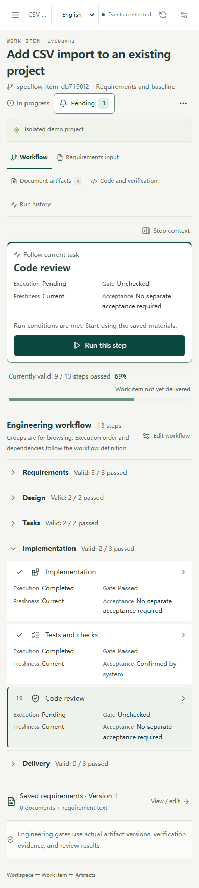

# English and Simplified Chinese

The desktop workbench, web application, and official DeepSeek Harness plugin support `en` and `zh-CN`. The header language selector is available before opening a project. The first launch follows the system/browser preference, and a saved selection takes precedence thereafter.

## Interface and generated content

The interface language controls navigation, dialogs, validation, accessibility labels, dates, runtime controls, system diagnostics, native desktop menus, updates, and the generated shell of HTML reading exports. It changes without remounting the workspace or discarding editor drafts.

New work items snapshot the selected language in `WorkflowDefinition.locale`. The workflow editor also exposes **Generated content language** for a new run of an existing work item. A run keeps its language and original execution configuration after later interface changes. Its prompts, evidence, model target, execution references, and historical documents are not rewritten.

English default workflows include English stage instructions, document/brief protocols, requirements clarification, both independent review perspectives, backend tool instructions, and the deterministic demo. The service writes clarification record headings in the run's language. All original engineering gates, permissions, IDs, verification requirements, and the dual document output limits remain enforced.

User requirements, uploaded/repository documents, custom names and instructions, source code, logs, model-authored content, clarification answers, and quoted evidence remain verbatim. Changing the interface language does not translate existing documents. Known default workflow names and stage objectives have a separate display mapping so they can be read in either interface language without changing the saved definition.

## Implementation

- `packages/i18n/` holds the supported locale type, language negotiation, message interpolation, date formatting, and English catalogs. Chinese source messages are stable keys. Complete known templates also support previously persisted system errors that already contain interpolated IDs.
- `apps/web/src/i18n.ts` provides the reactive locale store, browser preference, document language/title, and native desktop bridge. Status dictionaries resolve their labels when read, and locale-dependent requests reload their presentation metadata after a language change.
- The API client sends `Accept-Language`. The server sets `Content-Language` and translates explicitly selected system metadata fields. It preserves canonical JSON evidence exports and does not recursively translate domain objects. Direct HTML downloads include a validated `?locale=en` or `?locale=zh-CN` because anchor navigation cannot set the application's custom language header.
- The desktop saves `userData/locale.json` separately from engineering data. Preload reads the initial preference before the renderer starts, and changing it rebuilds native menus and persists the choice across changes of the backend port. The synchronous initial preference handler always replies and uses main-frame ownership rather than a URL check before navigation commits. Other desktop IPC retains its existing origin checks.
- DSH uses the same reactive UI locale store while leaving the host document's language and title alone. Its carrier-neutral RPC envelopes accept an optional validated locale; HTTP routes also accept `Accept-Language`. A locale change does not change command idempotency keys or existing execution identities.

The approved Apache Maka 0.2.0 release, source checksum, signer fingerprint, installation policy, and production packaging boundary are unchanged. Maka remains the bundled default; OpenCode remains a separately installed service.

## Verification

Validation was performed on Windows x64 on 2026-10-21.

- Main regression suite: 208 tests passed during integration. A further 43-test selection covered localization, clarification compatibility, backend selection, and execution identity after the English paths were connected.
- Final localization selection: 27 tests passed, including catalog coverage, language negotiation, interpolation, preserved user material, English execution and both reviews, native preference persistence, direct HTML download language, default workflow display, and runtime permission prompts.
- DSH tests: 19 passed. Main and plugin TypeScript checks, production builds, and `desktop:prepare` passed. Desktop preparation retained the approved signed-source Maka runtime verification.
- Web visual smoke: 26 surfaces passed at 1440×1000 and 390×1000, including all five tabs, reading/source/compare document views, five dialogs, and run drawers. It found no untranslated application text/accessibility labels, horizontal body overflow, or browser errors. It also verified draft retention, reloading the saved preference, and English HTML export with a Chinese browser language.
- Real Electron smoke: English first launch and demo, preload bridge, native menus and update actions, English → Chinese → English switching, and restart with a different backend port passed. Both exits stopped their backend, and the temporary profile was removed.
- DSH browser checks use the published client factory with the host's React 18 contract at a 420px panel width. They cover language switching, preserved user text and drafts, host document isolation, and layout.

Reproduce the web check after `npm run build` with `npm run smoke:localization`. Install Playwright Chromium or set `SPECFLOW_CHROMIUM` to an existing Chromium executable. Reproduce the native check after `npm run desktop:prepare` with `npm run desktop:smoke:localization`. The existing `scripts/dsh-client-smoke.mjs` also covers language switching after `npm run dsh:build` and requires the plugin's development dependencies.

Smoke scripts write reports and screenshots below `.tools/localization-qa/` and `.tools/dsh-client-qa/`. Review snapshots are saved beside this note in `localization-qa/`.

